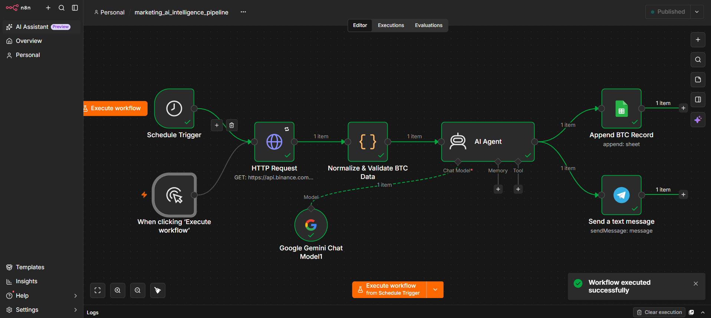
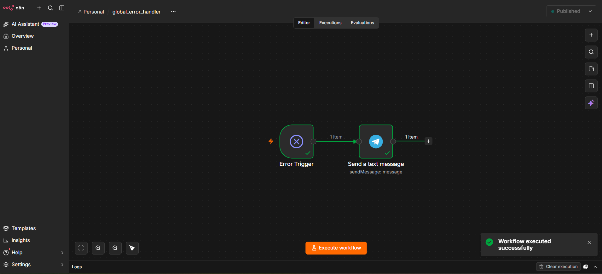

# ⚡ Automated Marketing Intelligence & AI Agent Pipeline (n8n)

[](workflows/marketing_ai_intelligence_pipeline.json)
[](#-ai-agent--prompt-engineering)
[](#-architecture--integrations)
[](LICENSE)

---

## 📌 Executive Summary

An enterprise-grade automation workflow built in **n8n** that orchestrates market data aggregation, data validation, generative AI synthesis, and multi-channel alerting. Designed for growth and marketing operations teams, this pipeline automates recurring competitive monitoring and trend analysis, replacing manual tracking with automated executive summaries.

The architecture incorporates scheduled and on-demand execution triggers, robust data schema normalization, an autonomous **Google Gemini AI Agent** for insight generation, automated logging in Google Sheets, and a dedicated **Global Error Handling sub-workflow** for production reliability.

---

## 📊 Workflow Architecture

### 1. Main Intelligence Pipeline


### 2. Global Error Handling & Monitoring


---

## 🛠 Technical Architecture & Integrations

The workflow is structured into four sequential operational stages:

1. **Trigger & Data Ingestion Layer:**
   * **Dual Triggers:** Automated daily/hourly execution via `Schedule Trigger` alongside manual invocation controls for ad-hoc auditing.
   * **REST API Ingestion:** Configured HTTP Request nodes consuming live market/trend telemetry with standardized response headers and status handling.

2. **Data Normalization & Sanitization (`Code Node`):**
   * Engineered JavaScript data parsing routines validating raw API payloads, transforming nested JSON arrays, handling missing attributes, and calculating percentage deviations prior to LLM submission.

3. **Autonomous AI Synthesis Layer (`Google Gemini Chat Model`):**
   * Integrated an autonomous AI Agent powered by Google Gemini.
   * Leveraged structured prompt constraints to transform raw data points into actionable marketing briefs, contextual highlights, and risk indicators.

4. **Distribution & Operations Layer:**
   * **Google Sheets Node:** Dynamically appends sanitized records and AI outputs into central operational tracking sheets for performance history.
   * **Telegram Integration:** Delivers instant, markdown-formatted executive alerts and summaries to targeted team channels.

5. **Fault Tolerance & Reliability (`Error Trigger`):**
   * Implemented a decoupled `Global_Error_Handler` workflow triggered automatically upon execution failures, dispatching immediate diagnostic telemetry (node name, error code, timestamp) to an on-call Telegram channel.

---

## 🚀 Setup & Deployment Instructions

1. **Clone the repository:**
   ```bash
   git clone [https://github.com/oleksandr-hordashevskyi/n8n-marketing-intelligence-ai-agent.git](https://github.com/oleksandr-hordashevskyi/n8n-marketing-intelligence-ai-agent.git)
   Import Workflow:

2. In your n8n instance, go to Workflows → Import from File.

- Select workflows/marketing_ai_intelligence_pipeline.json.

- Repeat for workflows/global_error_handler.json.

3. Configure Credentials:

- Add your Google Gemini API Key under Credentials.

- Connect your Telegram Bot Token and designate your alert channel Chat ID.

- Authenticate Google Sheets OAuth2 and specify your tracking spreadsheet.

4. Activate & Monitor:

- In workflow settings, assign Global_Error_Handler as the designated Error Workflow.

- Toggle the workflow to Active.

## 📁 Project Structure & Deliverables

```text
n8n-marketing-intelligence-ai-agent/
├── LICENSE
├── README.md
├── workflows/
│   ├── marketing_ai_intelligence_pipeline.json   # Main workflow
│   └── global_error_handler.json                 # Separate subflow for error interception
├── images/
│   ├── main_workflow_architecture.png            # Screenshot of the main flow
│   └── global_error_handler.png                  # Screenshot of the error handler
└── docs/
    └── setup_guide.md                            # Import and variable configuration guide
```
---
## ✉️ Contact

**Author:** Oleksandr Hordashevskyi

- LinkedIn: [Oleksandr Hordashevskyi](https://www.linkedin.com/in/oleksandr-hordashevskyi)
- Email: [o.hordashevskyi@gmail.com](mailto:o.hordashevskyi@gmail.com)
